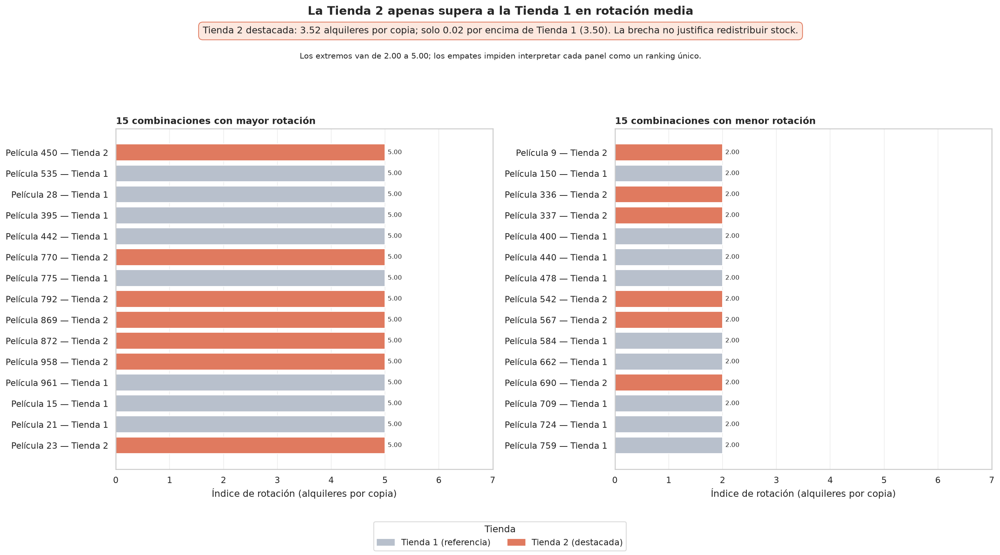
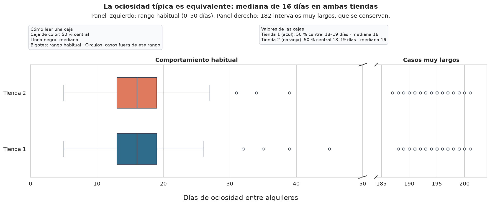
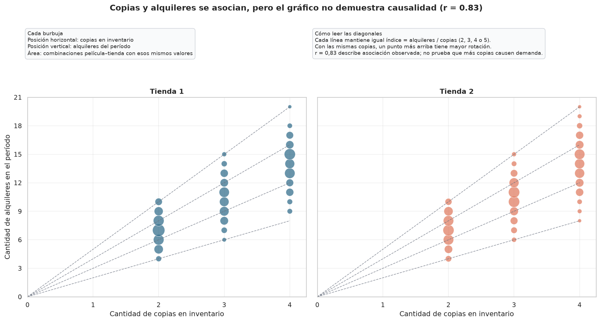

# Informe de conclusiones — Rotación del inventario por tienda

## Pregunta de negocio y respuesta

La variante analiza **qué copias del catálogo trabajan, cuáles permanecen inmovilizadas y si conviene redistribuir stock entre las tiendas**. Se calcularon, para cada combinación película–tienda con inventario, el índice de rotación (`alquileres / copias`) y los días de ociosidad entre la devolución de una copia y su alquiler siguiente.

La evidencia no respalda una redistribución masiva de stock entre tiendas: la rotación media es 3,50 alquileres por copia en la Tienda 1 y 3,52 en la Tienda 2. Sí habilita una revisión puntual de copias o películas con intervalos de ociosidad excepcionalmente largos, antes de decidir bajas o traslados. La única copia que nunca se alquiló es inventario inmovilizado confirmado; las 42 películas sin copias son un caso distinto, porque no hay stock que evaluar.

## Cómo se abordó

El conjunto de trabajo parte de `inventario`: así cada copia física participa del denominador. Se incorporó `pelicula` para identificarla y se aplicó `LEFT JOIN` a `alquiler`, de modo que una copia sin uso no desaparezca del análisis. Cada fila representa una copia y, cuando existe, uno de sus alquileres. La consulta está documentada en [`sql/actividad_1/conjunto_trabajo.sql`](../sql/actividad_1/conjunto_trabajo.sql).

SQL Server resolvió los `JOIN`, las agregaciones y el cálculo alternativo con `LAG`, que reducen y ordenan el trabajo cercano a los datos. En pandas se realizaron el perfilado, el contraste con T-SQL, el cálculo vectorizado de intervalos con `groupby` + `shift` y las visualizaciones. Esta división conserva las copias sin alquiler y permite revisar con claridad cada cálculo en el [notebook ejecutado](../notebooks/analisis.ipynb).

## Decisiones de diseño y repetibilidad

- **Consultas y conexión.** Los nombres de tablas y columnas se resuelven desde [`esquema.py`](../esquema.py); no se interpolan valores variables en consultas. `SQLAlchemy` con `mssql+pyodbc` y **ODBC Driver 18 for SQL Server** permite que `pandas.read_sql` y `to_sql` compartan el mismo engine. Las credenciales proceden de las variables de entorno `DB_SERVER`, `DB_NAME`, `DB_USER` y `DB_PASSWORD`, fuera del repositorio.
- **Limpieza conservadora.** Los nulos no se descartaron por defecto: la copia sin alquiler se conserva en el denominador y los alquileres abiertos se mantienen como tales. La ociosidad sólo se calcula cuando existe una devolución anterior y un alquiler posterior; no se inventa un valor de cero días.
- **Segundo origen y carga.** El CSV [`metas_rotacion_tienda.csv`](../pipeline/datos/metas_rotacion_tienda.csv) agrega metas operativas declaradas por tienda. Se valida antes del cruce y se combina mediante `merge(..., validate="many_to_one")`. El resultado se carga como una fotografía en `dbo.TP2_RotacionInventario`: una transacción borra la fotografía anterior, inserta la nueva y comprueba el conteo antes de confirmar. La clave primaria `(pelicula_id, tienda_id)` protege el grano de una fila por película y tienda.

La evidencia de dos ejecuciones consecutivas confirma 1.521 filas y 1.521 claves película–tienda en ambos casos; por lo tanto, la segunda ejecucón reemplaza la fotografía y no suma duplicados. El detalle está en [`pipeline/evidencias/actividad_4_doble_ejecucion.txt`](../pipeline/evidencias/actividad_4_doble_ejecucion.txt).

## Calidad de datos e impacto sobre la lectura

El conjunto contiene 16.045 filas: 16.044 alquileres y una copia sin alquiler asociado. No se hallaron alquileres duplicados, devoluciones anteriores al alquiler, alquileres sin copia, inconsistencias entre copia, película y tienda ni valores atípicos del índice de rotación por el criterio IQR (Q1 = 3,00; Q3 = 4,00; límites 1,50–5,50).

Los faltantes describen situaciones del negocio y se conservaron: hay una copia nunca alquilada y 184 devoluciones faltantes, que representan alquileres abiertos. También hay 42 películas del catálogo sin una copia en inventario. Esta última cifra no mide películas inmovilizadas ni de baja demanda: sin stock, no existe una combinación película–tienda ni un denominador para calcular su rotación.

La consecuencia principal es temporal. Los alquileres registrados abarcan del 24/05/2005 al 14/02/2006, mientras que las devoluciones llegan sólo hasta el 02/09/2005; existen 182 alquileres posteriores a esa última devolución. Por ello, la rotación se puede leer para las copias existentes durante el período, pero la ociosidad sólo representa los intervalos completos observables. El diagnóstico y los contrastes pandas–T-SQL están desarrollados en [`diagnostico_calidad.md`](diagnostico_calidad.md).

## Hallazgo 1 — No hay una brecha operativa de rotación entre tiendas

La rotación media fue **3,50** alquileres por copia en la Tienda 1 y **3,52** en la Tienda 2: una diferencia de **0,02**. Los inventarios (2.270 y 2.311 copias) y los alquileres (7.923 y 8.121) también son cercanos. El gráfico muestra 15 combinaciones película–tienda de mayor y menor rotación: los extremos van de 2,00 a 5,00 y hay empates, por lo que los paneles no constituyen un ranking estricto entre películas con el mismo valor.

*Figura 1. Índice de rotación del período observado, en alquileres por copia, para las 15 combinaciones película–tienda de mayor y menor valor. Fuente: [notebook de análisis](../notebooks/analisis.ipynb).*

**Decisión habilitada.** No trasladar stock masivamente entre tiendas sólo por este índice. Una eventual revisión debe realizarse por película y complementarse con demanda por período y por sucursal.

## Hallazgo 2 — La ociosidad típica es igual, aunque hay casos excepcionales

Sobre **11.464 intervalos medibles**, ambas tiendas tienen una mediana de **16 días** y un rango intercuartílico de **13 a 19 días**. La distribución central, entonces, es comparable. A la vez, se observan intervalos de hasta **201 días**. Como el gráfico conserva esos extremos, muestra que son casos que requieren revisión y no evidencia de que una tienda completa tenga peor ociosidad.

*Figura 2. Días de ociosidad entre una devolución y el alquiler siguiente, para los intervalos completos del período observado. Fuente: [notebook de análisis](../notebooks/analisis.ipynb).*

**Decisión habilitada.** Revisar individualmente las películas o copias con intervalos excepcionalmente largos antes de proponer bajas o traslados; no aplicar una regla global por tienda.

## Hallazgo 3 — El volumen bruto no equivale a eficiencia por copia

La cantidad de copias y la cantidad de alquileres presentan una asociación lineal alta: **r = 0,83**. Una película con más copias tiende a acumular más alquileres aun cuando cada copia rote a un ritmo similar. En consecuencia, el total de alquileres describe volumen, pero no separa ese volumen de la eficiencia de cada copia.

*Figura 3. Cantidad de copias en inventario y cantidad de alquileres por combinación película–tienda durante el período observado; las diagonales mantienen un mismo índice de rotación. Fuente: [notebook de análisis](../notebooks/analisis.ipynb).*

**Decisión habilitada.** Usar rotación y ociosidad para comparar películas o tiendas; conservar los alquileres totales como contexto de volumen. La correlación describe una asociación en este conjunto y no demuestra que agregar copias cause demanda.

## Limitaciones

- El período observado describe alquileres registrados; no permite pronosticar demanda futura.
- La ociosidad sólo se mide entre una devolución anterior y un alquiler siguiente. Los primeros alquileres de una copia y los alquileres abiertos no aportan un intervalo, y no se les asignó artificialmente cero días.
- La cobertura de devoluciones no alcanza todo el período de alquileres: existen 182 alquileres posteriores a la última devolución registrada. Esto limita la interpretación temporal de la ociosidad y de la duración.
- El índice no controla estacionalidad, duración de alquiler, género, precio, demanda por sucursal ni tiempo de exposición de cada copia. Una película con una copia alquilada 20 veces y otra con ocho copias alquiladas 40 veces tienen índices distintos (20 y 5), pero la comparación aún omite esos factores.
- La comparación entre tiendas no demuestra causas ni alcanza para justificar una redistribución masiva sin información adicional.

## Dificultades resueltas

- **Criterio de días entre herramientas.** Una comparación inicial produjo diferencias de 0,01 en algunos promedios porque se redondeaba antes de contrastar. Se alineó `DATEDIFF(DAY, ...)` de T-SQL con pandas normalizando las fechas y se compararon valores sin formato de presentación.
- **Empates en el gráfico obligatorio.** Las 15 combinaciones extremas comparten valores de 2,00 o 5,00; presentarlas como un ranking único habría sido engañoso. Se conservaron los empates y se explicitó su alcance en el título y la anotación de la Figura 1.
- **Repetición segura del ETL.** Para evitar que una segunda ejecución duplicara combinaciones, la carga reemplaza el snapshot dentro de una transacción y la clave primaria impide duplicados. Las dos ejecuciones documentadas dejaron el mismo conteo de 1.521 filas.

## Cierre

El inventario de las dos tiendas muestra una rotación media prácticamente equivalente; por eso los datos actuales no sostienen un traslado amplio de stock. La acción defendible es una revisión focalizada de los intervalos de ociosidad muy largos y de la copia nunca alquilada, incorporando antes información de demanda, estacionalidad y cobertura de devoluciones. Así se evita confundir volumen con eficiencia y se preserva el alcance real de los datos.
